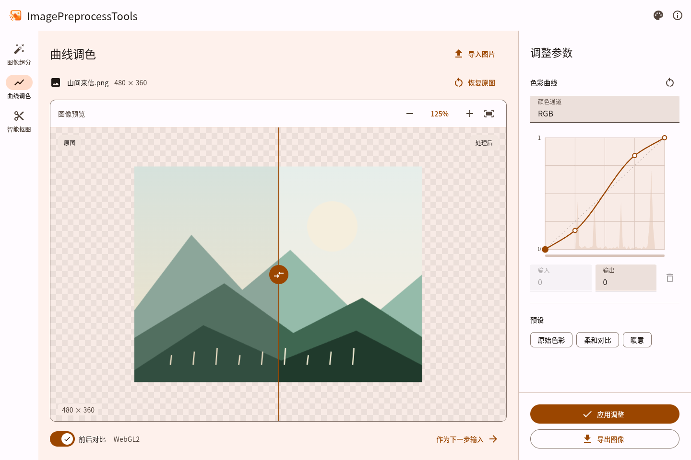
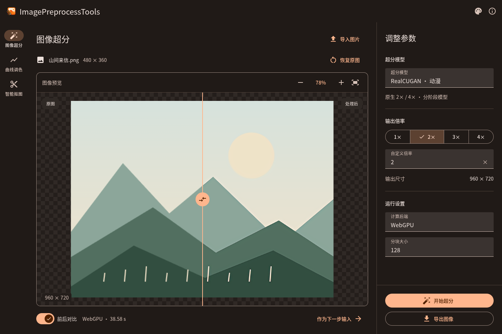

<p align="center">
  
</p>

# ImagePreprocessTools

浏览器中的本地图像处理工具，使用 Vue 3、TypeScript 和 mdui 2 构建。图片在设备上处理，无需上传。

- **图像超分辨率**：RealCUGAN、Real-ESRGAN，支持照片和动漫图片、1～4 倍输出及 WebGPU / WebGL / WASM 后端。
- **曲线调色**：调整 RGB、各颜色通道、色相、饱和度和明度。
- **智能抠图**：轻量 U²-Net 模型，支持边缘收缩、扩张、羽化和遮罩预览。
- 支持原图对比、结果复用、PNG / JPEG / WebP 导出，以及自定义主题色。

在线使用：**https://tool.talium.site/ImagePreprocessTools/**

## 界面预览

曲线调色与原图对比：



RealCUGAN 超分辨率与原图对比（深色）：



## 本地运行

需要 Node.js 22.12 或更新版本。

```bash
npm ci
npm run dev
```

打开 http://127.0.0.1:5188/ 。生产构建使用 `npm run build`，预览使用 `npm run preview`。

## 开源许可

本项目采用 [GNU AGPL v3](LICENSE)（`AGPL-3.0-only`）。第三方模型保留各自的 [许可证](public/licenses/)。

## 第三方依赖与模型

感谢以下开源项目。第三方代码、图标和模型沿用各自许可证。

| 项目 | 用途 | 许可证 |
| --- | --- | --- |
| [Vue 3](https://github.com/vuejs/core) | 页面与状态管理 | MIT |
| [mdui 2 / @mdui/icons](https://github.com/zdhxiong/mdui) | Material Design 控件与图标组件 | MIT |
| [Material Icons](https://github.com/google/material-design-icons) | 图标原始设计，通过 @mdui/icons 引入 | [Apache-2.0](https://github.com/google/material-design-icons/blob/master/LICENSE) |
| [ONNX Runtime Web](https://github.com/microsoft/onnxruntime) | WebGPU / WebGL / WASM 推理 | [MIT](https://github.com/microsoft/onnxruntime/blob/main/LICENSE) |
| [onnx-proto](https://github.com/chaosmail/onnx-proto) / [protobufjs](https://github.com/protobufjs/protobuf.js) | ONNX 图解码与 WebGL 元数据适配 | MIT / BSD-3-Clause |
| [RealCUGAN](https://github.com/bilibili/ailab/tree/main/Real-CUGAN) | 动漫超分模型与分块适配依据 | [MIT](public/licenses/cugan.txt) |
| [Real-ESRGAN](https://github.com/xinntao/Real-ESRGAN) | 照片与动漫轻量超分模型 | [BSD-3-Clause](public/licenses/esrgan.txt) |
| [U²-Net](https://github.com/xuebinqin/U-2-Net) | U2NetP 前景分割模型 | [Apache-2.0](public/licenses/u2net.txt) |
| [rembg](https://github.com/danielgatis/rembg) | U2NetP ONNX 权重来源与预处理参考 | [MIT](https://github.com/danielgatis/rembg/blob/main/LICENSE.txt) |

开发依赖：Vite、@vitejs/plugin-vue、vue-tsc、Vitest、@types/node（MIT）；TypeScript、@playwright/test（Apache-2.0）；@webgpu/types（BSD-3-Clause）。直接依赖见 [package.json](package.json)，完整依赖树与锁定版本见 [package-lock.json](package-lock.json)。可选的 Python 模型重建依赖见 [requirements-models.txt](scripts/requirements-models.txt)，权重来源及校验值见 [model-sources.lock.json](scripts/model-sources.lock.json)。

技术说明与测试记录见 [docs/architecture.md](docs/architecture.md) 和 [docs/verification/README.md](docs/verification/README.md)；部署方法见 [docs/deployment.md](docs/deployment.md)。
